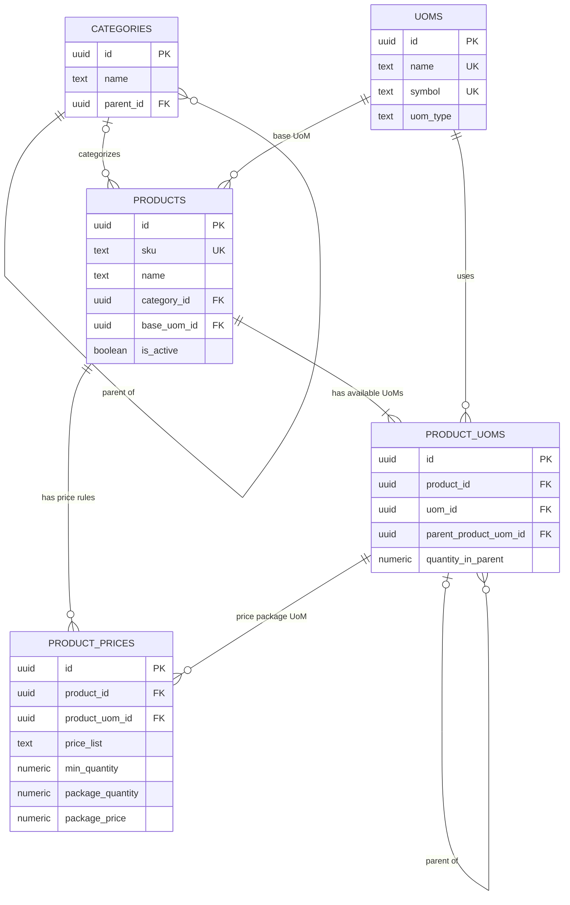

# Product Database Design

**Project:** Shop Management App  
**Scope:** Product Management  
**Database:** PostgreSQL (Supabase)  
**Status:** Initial design

## 1. Purpose

This document defines the relational database design for product management. It covers:

- Product categories, including nested categories.
- Products and their base unit of measure (UoM).
- Product-specific UoM options and hierarchical conversions.
- Package-based prices and quantity-based pricing rules.

The design is intended to remain simple for the initial Product Management module while allowing future modules such as inventory, purchasing, and sales to reuse the same product data.

## 2. Design Principles

1. **Keep entities separate.** Product identity, reusable units, product-specific conversions, and pricing rules belong in separate tables.
2. **Use a base UoM.** Quantities can be normalized to a product's base unit for inventory and calculations.
3. **Model conversions per product.** A box may contain 24 pieces for one product and 12 pieces for another.
4. **Store package prices explicitly.** A package price is the price for the configured package, not automatically the price of one base unit.
5. **Use relational constraints.** Foreign keys and unique constraints protect data consistency.
6. **Use decimal types for quantities and money.** Avoid floating-point types for conversion factors, quantities, and prices.

## 3. Entity Relationship Diagram



**Relationship notes**

- A category can contain many subcategories and products.
- A product can have one category; `category_id` may be nullable if uncategorized products are allowed.
- Each product has one configured base UoM.
- A product can offer multiple UoMs through `product_uoms`.
- A product UoM can optionally reference a parent product UoM to form a hierarchy.
- A product can have multiple price rules.
- Each price rule references a product UoM belonging to the same product.

> Implementation note: the ERD describes the conceptual relationships. The database should additionally enforce that each product's base UoM is represented in `product_uoms`, and that UoM hierarchies contain no cycles. These rules may require deferred constraints, triggers, or transaction-level service validation.

## 4. Tables

### 4.1 `categories`

Stores product categories and optional nested categories.

| Column | Type | Constraints | Description |
|---|---|---|---|
| `id` | `uuid` | Primary key | Category identifier |
| `name` | `text` | Not null | Category name |
| `parent_id` | `uuid` | Nullable FK to `categories.id` | Parent category |

Example hierarchy:

```text
Food
└── Beverages
    └── Mineral Water
```

Recommended rules:

- Prevent category cycles.
- Decide whether category names must be unique globally or only within the same parent.
- Prevent deletion of categories that are still referenced by products, or reassign those products first.

### 4.2 `uoms`

Stores reusable unit definitions.

| Column | Type | Constraints | Description |
|---|---|---|---|
| `id` | `uuid` | Primary key | UoM identifier |
| `name` | `text` | Unique, not null | Full unit name |
| `symbol` | `text` | Unique, not null | Display symbol |
| `uom_type` | `text` | Not null | Measurement family, such as `unit`, `weight`, or `volume` |

Examples include `Piece (pcs)`, `Pack (pack)`, `Box (box)`, `Kilogram (kg)`, and `Liter (L)`.

Only compatible measurement families should be convertible. For example, converting pieces to kilograms should not be allowed unless the application explicitly models a product-specific weight conversion.

### 4.3 `products`

Stores core product information.

| Column | Type | Constraints | Description |
|---|---|---|---|
| `id` | `uuid` | Primary key | Product identifier |
| `sku` | `text` | Unique, not null | Internal stock-keeping unit |
| `name` | `text` | Not null | Product name |
| `category_id` | `uuid` | FK to `categories.id` | Product category |
| `base_uom_id` | `uuid` | FK to `uoms.id`, not null | Base unit for normalized quantities |
| `is_active` | `boolean` | Not null, default `true` | Whether the product is available |

The base UoM is the unit used to normalize quantities. For a bottled drink, the base UoM might be `pcs`.

### 4.4 `product_uoms`

Defines which UoMs are available for a particular product and how they relate hierarchically.

| Column | Type | Constraints | Description |
|---|---|---|---|
| `id` | `uuid` | Primary key | Product-UoM record identifier |
| `product_id` | `uuid` | FK to `products.id`, not null | Related product |
| `uom_id` | `uuid` | FK to `uoms.id`, not null | Unit definition |
| `parent_product_uom_id` | `uuid` | Nullable self-reference | Immediate parent unit in the hierarchy |
| `quantity_in_parent` | `numeric(18,6)` | Greater than zero | Number of parent units contained in this unit |

Example:

| UoM | Parent UoM | `quantity_in_parent` | Meaning |
|---|---|---:|---|
| pcs | — | 1 | Base unit |
| pack | pcs | 6 | 1 pack = 6 pcs |
| box | pack | 4 | 1 box = 4 packs = 24 pcs |

For this example, `quantity_in_parent` means the number of parent units represented by one unit of the current row. Therefore, the conversion from box to base units is `4 × 6 = 24 pcs`.

**The base UoM does not have to be the smallest unit.** The base is simply the root of the conversion tree; a unit smaller than the base stores a fractional `quantity_in_parent` (for example `1 pcs = 0.041667 box` when `box` is the base). Conversions are always resolved by multiplying `quantity_in_parent` along the path up to the base.

Enforced rules (see migration `20261014120000_product_uom_tree_integrity.sql`):

- A product has exactly one parentless row per `product_uoms` tree, and it must be the row for `products.base_uom_id` with `quantity_in_parent = 1`. This is checked by a deferred constraint trigger at commit time.
- Every non-base UoM therefore has a parent.
- A UoM cannot be its own ancestor, directly or indirectly (cycle guard trigger).
- A parent's UoM and child's UoM must share the same `uoms.uom_type` (measurement family).
- A product must not have duplicate UoM definitions (unique `(product_id, uom_id)`).

Changing `products.base_uom_id` to a unit that is already part of the product re-roots the tree: the path from the new base up to the old root is reversed and each factor inverted, so relative conversions and existing price rules are preserved. Changing the base to an unrelated unit is rejected while the product still has other units or price rules; add the desired base as a unit first, then promote it.

A self-referencing foreign key ensures the parent belongs to the same product (composite foreign key). Cycle detection and the single-root invariant need the additional trigger validation noted above.

### 4.5 `product_prices`

Stores package-based price rules. `package_price` is the price for one configured package, not the price of one individual base unit.

| Column | Type | Constraints | Description |
|---|---|---|---|
| `id` | `uuid` | Primary key | Price rule identifier |
| `product_id` | `uuid` | FK to `products.id`, not null | Related product |
| `product_uom_id` | `uuid` | FK to `product_uoms.id`, not null | UoM used to express the package |
| `price_list` | `text` | Not null, default `retail` | Price list, e.g. `retail` or `wholesale` |
| `min_quantity` | `numeric(18,6)` | Greater than zero | Minimum order quantity that activates the rule |
| `package_quantity` | `numeric(18,6)` | Greater than zero | Number of units included in one priced package |
| `package_price` | `numeric(18,2)` | Zero or greater | Price for one package |

`product_uom_id` and `package_quantity` have different purposes:

- `product_uom_id` identifies the unit used for the price package, such as `pcs` or `box`.
- `package_quantity` records how many units are included in one package, expressed in the referenced UoM.
- `min_quantity` determines the minimum order quantity at which the price rule becomes eligible.
- `package_price` is the amount charged for one package.

**Important modeling decision:** this schema supports package prices selected by minimum order quantity. The application must define whether the price package must be purchased in whole multiples or whether the package price is only a pricing tier for an order. If whole-package purchasing is required, enforce package multiples in the sales/order validation logic.

A unique constraint should prevent duplicate rules for the same product, price UoM, price list, and minimum quantity.

## 5. Example Data and Price Selection

Consider a product with the following package price rules:

| Price list | Price UoM | Minimum order quantity | Package quantity | Package price |
|---|---|---:|---:|---:|
| retail | pcs | 1 | 1 | Rp2,500 |
| wholesale | pcs | 12 | 12 | Rp26,400 |
| wholesale | pcs | 24 | 24 | Rp48,000 |
| retail | box | 1 | 1 | Rp50,000 |

Interpretation:

- One `pcs` package costs Rp2,500.
- The 12-piece package costs Rp26,400.
- The 24-piece package costs Rp48,000.
- One `box` package costs Rp50,000; its physical contents are determined by the product's UoM conversion hierarchy.

If the customer orders 24 pcs, the pricing logic can select the applicable 24-piece rule and charge Rp48,000, assuming the order matches the selected price list and package policy. The system must not automatically calculate `2 × Rp26,400` unless that is the intended pricing policy.

### Recommended price resolution

1. Identify the product and selected price list.
2. Convert the requested quantity to a consistent comparison unit when price rules use different UoMs.
3. Find eligible price rules whose minimum quantity is less than or equal to the requested quantity.
4. Select the most specific eligible rule according to the configured policy, usually the highest applicable minimum quantity.
5. Apply the package-multiple rule, if whole packages are required.
6. Calculate the order line total and retain the applied price and rule details on the transaction.

Avoid mixing price rules expressed in incompatible UoMs without a defined normalization and selection policy.

## 6. Suggested PostgreSQL Schema

The following SQL is a starting point for Supabase. It includes core keys and constraints, but it does not by itself enforce every business rule described above.

```sql
create table categories (
  id uuid primary key default gen_random_uuid(),
  name text not null,
  parent_id uuid references categories(id),
  unique (parent_id, name)
);

create table uoms (
  id uuid primary key default gen_random_uuid(),
  name text not null unique,
  symbol text not null unique,
  uom_type text not null
    check (uom_type in ('unit', 'weight', 'volume'))
);

create table products (
  id uuid primary key default gen_random_uuid(),
  sku text not null unique,
  name text not null,
  category_id uuid references categories(id),
  base_uom_id uuid not null references uoms(id),
  is_active boolean not null default true
);

create table product_uoms (
  id uuid primary key default gen_random_uuid(),
  product_id uuid not null references products(id),
  uom_id uuid not null references uoms(id),
  parent_product_uom_id uuid,
  quantity_in_parent numeric(18, 6) not null
    check (quantity_in_parent > 0),

  unique (product_id, uom_id),
  unique (id, product_id),

  foreign key (parent_product_uom_id, product_id)
    references product_uoms(id, product_id),

  check (
    parent_product_uom_id is null
    or id <> parent_product_uom_id
  )
);

create table product_prices (
  id uuid primary key default gen_random_uuid(),
  product_id uuid not null references products(id),
  product_uom_id uuid not null,
  price_list text not null default 'retail',
  min_quantity numeric(18, 6) not null
    check (min_quantity > 0),
  package_quantity numeric(18, 6) not null
    check (package_quantity > 0),
  package_price numeric(18, 2) not null
    check (package_price >= 0),

  foreign key (product_uom_id, product_id)
    references product_uoms(id, product_id),

  unique (
    product_id,
    product_uom_id,
    price_list,
    min_quantity
  )
);
```

### Additional integrity work

Before production, implement and test these rules:

- Ensure `products.base_uom_id` matches the base `product_uoms` row for that product.
- Ensure exactly one base UoM exists for each product.
- Prevent cycles in `product_uoms` and `categories`.
- Ensure child and parent UoMs are compatible.
- Decide how `min_quantity` is expressed when rules use different UoMs.
- Add indexes for common lookups, such as products by category and price rules by product and price list.
- Configure Supabase Row Level Security (RLS) policies for the intended users and roles.

## 7. Application Responsibilities

The database stores the canonical product, UoM, and price-rule data. The application is responsible for:

- Showing product UoM hierarchies in a readable form.
- Calculating conversions between a selected UoM and the base UoM.
- Selecting an applicable price rule consistently.
- Validating package multiples when required.
- Keeping a copy of the actual unit/package price and relevant price details on each completed transaction, so historical totals do not change when a price rule is edited later.

For an offline-first application, local data and pending changes should use stable IDs. Price resolution and conversion rules should be shared between online and offline flows wherever possible, and conflicting edits should be handled explicitly during synchronization.

## 8. Scope and Future Extensions

This initial design covers product master data and package-based pricing. It does not yet model:

- Stock balances and stock movements.
- Suppliers and purchase prices.
- Sales orders, order lines, discounts, and taxes.
- Multiple currencies or effective date ranges for prices.
- Lot/serial tracking or product variants.

These can be added as separate modules without embedding inventory or sales transaction state into the `products` table.

## 9. Summary

The core model consists of five tables:

- `categories`
- `uoms`
- `products`
- `product_uoms`
- `product_prices`

The key distinction is that UoM conversion defines how physical quantities relate, while package pricing defines how much a particular package costs and when that price is applicable. Keeping these concepts separate provides a clear foundation for Product Management and future inventory and sales modules.
