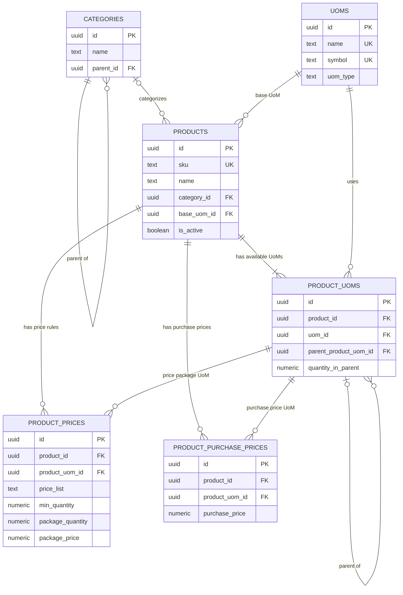

# Product Database Design

**Project:** Shop Management App  
**Scope:** Product Management  
**Database:** PostgreSQL (Supabase)  
**Status:** Initial design

## 1. Purpose

This document defines the relational database design for product management. It covers:

- Product categories, including nested categories.
- Products and their base unit of measure (UoM).
- Product-specific UoM options, with reusable global conversion trees and per-product overrides.
- Package-based prices and quantity-based pricing rules.
- Purchase prices recorded per product UoM, with conversion-based derivation.

The design is intended to remain simple for the initial Product Management module while allowing future modules such as inventory, purchasing, and sales to reuse the same product data.

## 2. Design Principles

1. **Keep entities separate.** Product identity, reusable units, product-specific conversions, and pricing rules belong in separate tables.
2. **Use a base UoM.** Quantities can be normalized to a product's base unit for inventory and calculations.
3. **Share conversions by default.** Define a reusable global conversion tree once per UoM. Most products inherit it without repeating the same factors.
4. **Allow explicit local overrides.** A box may contain 24 pieces for one product and 12 pieces for another. Each product UoM chooses `global` or `local` independently.
5. **Store package prices explicitly.** A package price is the price for the configured package, not automatically the price of one base unit.
6. **Record purchase prices per unit.** A purchase price belongs to a specific product UoM; prices for units that have none are derived from a recorded price using the conversion hierarchy.
7. **Use relational constraints.** Foreign keys and unique constraints protect data consistency.
8. **Use decimal types for quantities and money.** Avoid floating-point types for conversion factors, quantities, and prices.

## 3. Entity Relationship Diagram



**Relationship notes**

- A category can contain many subcategories and products.
- A product can have one category; `category_id` may be nullable if uncategorized products are allowed.
- Each product has one configured base UoM.
- A product can offer multiple UoMs through `product_uoms`.
- A product UoM can optionally reference a parent product UoM to form a hierarchy.
- A product can have multiple price rules.
- Each price rule references a product UoM belonging to the same product.
- A product can have at most one purchase price recorded per UoM it offers.
- Each purchase price references a product UoM belonging to the same product.
- Units without a recorded purchase price are derived by the application from a recorded price using the conversion hierarchy.

> Implementation note: the ERD describes the conceptual relationships. The database should additionally enforce that each product's base UoM is represented in `product_uoms`, and that UoM hierarchies contain no cycles. These rules may require deferred constraints, triggers, or transaction-level service validation.

## 4. Tables

### 4.1 `categories`

Stores product categories and optional nested categories.

| Column | Type | Constraints | Description |
|---|---|---|---|
| `id` | `uuid` | Primary key | Category identifier |
| `name` | `text` | Not null | Category name |
| `parent_id` | `uuid` | Nullable FK to `categories.id` | Parent category |

Example hierarchy:

```text
Food
└── Beverages
    └── Mineral Water
```

Recommended rules:

- Prevent category cycles.
- Decide whether category names must be unique globally or only within the same parent.
- Prevent deletion of categories that are still referenced by products, or reassign those products first.

### 4.2 `uoms`

Stores reusable unit definitions.

| Column | Type | Constraints | Description |
|---|---|---|---|
| `id` | `uuid` | Primary key | UoM identifier |
| `name` | `text` | Unique, not null | Full unit name |
| `symbol` | `text` | Unique, not null | Display symbol |
| `uom_type` | `text` | Not null | Measurement family, such as `unit`, `weight`, or `volume` |
| `global_parent_uom_id` | `uuid` | Nullable self-reference, same `uom_type`, no cycles | Parent in the reusable global conversion tree |
| `global_quantity_in_parent` | `numeric(18,6)` | Nullable, greater than zero, set iff the parent is set | How many parent units one of this unit equals globally |

Examples include `Piece (pcs)`, `Pack (pack)`, `Box (box)`, `Kilogram (kg)`, and `Liter (L)`.

Only compatible measurement families can be converted. A global parent and child must share the same `uom_type`, and a unit cannot be its own global ancestor. A UoM with global children cannot change its `uom_type` until those child links are removed or reassigned, so an existing tree cannot be split across families.

**Global conversions are reusable defaults for every UoM type.** A UoM with no `global_parent_uom_id` is a root. Each non-root UoM defines its conversion to one parent, and the application multiplies the chain:

| UoM | Global parent | `global_quantity_in_parent` | Meaning |
|---|---|---:|---|
| g | — | — | Weight root |
| kg | g | 1000 | 1 kg = 1000 g |
| mg | g | 0.001 | 1 mg = 0.001 g |
| karung | kg | 50 | 1 karung = 50 kg |
| mL | — | — | Volume root |
| L | mL | 1000 | 1 L = 1000 mL |
| pcs | — | — | Unit root |
| pack | pcs | 6 | Optional shared default: 1 pack = 6 pcs |
| box | pack | 4 | Optional shared default: 1 box = 4 packs = 24 pcs |

Global conversions are optional. For example, a product may use `pack` and `box` with different quantities, so those UoMs can stay as independent roots and each product can define local conversions instead. The demo seed configures the common metric weight and volume trees because they are normally identical across products.

### 4.3 `products`

Stores core product information.

| Column | Type | Constraints | Description |
|---|---|---|---|
| `id` | `uuid` | Primary key | Product identifier |
| `sku` | `text` | Unique, not null | Internal stock-keeping unit |
| `name` | `text` | Not null | Product name |
| `category_id` | `uuid` | FK to `categories.id` | Product category |
| `base_uom_id` | `uuid` | FK to `uoms.id`, not null | Base unit for normalized quantities |
| `is_active` | `boolean` | Not null, default `true` | Whether the product is available |

The base UoM is the unit used to normalize quantities. For a bottled drink, the base UoM might be `pcs`.

### 4.4 `product_uoms`

Defines which UoMs are available for a particular product and how they relate hierarchically.

| Column | Type | Constraints | Description |
|---|---|---|---|
| `id` | `uuid` | Primary key | Product-UoM record identifier |
| `product_id` | `uuid` | FK to `products.id`, not null | Related product |
| `uom_id` | `uuid` | FK to `uoms.id`, not null | Unit definition |
| `parent_product_uom_id` | `uuid` | Nullable self-reference | Immediate parent unit in the product hierarchy |
| `quantity_in_parent` | `numeric(18,6)` | Greater than zero | Number of parent units contained in this unit |
| `conversion_mode` | `text` | `global` or `local`, not null, default `local` | Whether this row inherits the UoM global conversion or uses its stored local conversion |

Example:

| UoM | Parent UoM | `quantity_in_parent` | Meaning |
|---|---|---:|---|
| pcs | — | 1 | Base unit |
| pack | pcs | 6 | 1 pack = 6 pcs |
| box | pack | 4 | 1 box = 4 packs = 24 pcs |

For this example, `quantity_in_parent` means the number of parent units represented by one unit of the current row. Therefore, the conversion from box to base units is `4 × 6 = 24 pcs`.

**The base UoM does not have to be the smallest unit.** The base is simply the root of the conversion tree; a unit smaller than the base stores a fractional `quantity_in_parent` (for example `1 pcs = 0.041667 box` when `box` is the base). Conversions are always resolved by multiplying `quantity_in_parent` along the path up to the base.

**Each product row chooses its conversion source independently.** This is what allows a product to inherit global metric conversions while overriding just one unit:

| Product UoM | Mode | Stored link | Effective factor to base |
|---|---|---|---|
| kg (base) | global or local | root | 1 |
| g | `global` | direct child of base, snapshot factor 0.001 | uses global `g -> kg` |
| karung | `local` | parent kg, `quantity_in_parent = 25` | 25 kg |
| L | `global` | direct child of base if the base is a volume unit | uses global `L -> mL` |

- A `global` row ignores its stored `parent_product_uom_id` and `quantity_in_parent` for conversion. It resolves the unit through the global UoM tree relative to the product base. Editing `kg` or `L` once therefore updates every inheriting product. The stored values are still kept as a snapshot because the product tree constraints and price rules require a connected hierarchy.
- A `local` row uses its stored `parent_product_uom_id` and `quantity_in_parent`. A local row may point at a global row, in which case the ancestor's global factor is used. For example, `1 karung = 25 kg` remains local while `kg` continues to inherit the global tree.
- If a global conversion is unavailable (for example, the product uses a different global root), a `global` row falls back to its stored local tree so the product remains usable. The UI shows the effective source.
- Switching a row to local prefills the current global factor, so the user only adjusts the value that differs. A "Use global" action restores inheritance.

Enforced rules (see `20261014120000_product_uom_tree_integrity.sql`, `20261026120000_global_uom_conversions.sql`, and `20261029100000_allow_product_cross_type_uoms.sql`):

- A product has exactly one parentless row per `product_uoms` tree, and it must be the row for `products.base_uom_id` with `quantity_in_parent = 1`. This is checked by a deferred constraint trigger at commit time.
- Every non-base UoM therefore has a parent.
- A UoM cannot be its own ancestor, directly or indirectly (cycle guard trigger).
- Global conversions (`uoms` table) strictly require parent and child to share the same `uoms.uom_type` (measurement family).
- Product-specific local conversions (`product_uoms` with `conversion_mode = 'local'`) may span measurement families to support cross-type items (e.g., eggs where $1\text{ pc} = 0.0625\text{ kg}$). These represent nominal/average ratios, while periodic inventory stocktakes absorb natural physical weight variances.
- A product must not have duplicate UoM definitions (unique `(product_id, uom_id)`).
- Global parents on `uoms` use the same family and cycle rules; the parent and quantity are both null (root) or both set.

Changing `products.base_uom_id` to a unit that is already part of the product re-roots the tree: the path from the new base up to the old root is reversed and each factor inverted, so relative conversions and existing price rules are preserved. Changing the base to an unrelated unit is rejected while the product still has other units or price rules; add the desired base as a unit first, then promote it.

A self-referencing foreign key ensures the parent belongs to the same product (composite foreign key). Cycle detection and the single-root invariant need the additional trigger validation noted above.

### 4.5 `product_prices`

Stores package-based price rules. `package_price` is the price for one configured package, not the price of one individual base unit.

| Column | Type | Constraints | Description |
|---|---|---|---|
| `id` | `uuid` | Primary key | Price rule identifier |
| `product_id` | `uuid` | FK to `products.id`, not null | Related product |
| `product_uom_id` | `uuid` | FK to `product_uoms.id`, not null | UoM used to express the package |
| `price_list` | `text` | Not null, default `retail` | Price list, e.g. `retail` or `wholesale` |
| `min_quantity` | `numeric(18,6)` | Greater than zero | Minimum order quantity that activates the rule |
| `package_quantity` | `numeric(18,6)` | Greater than zero | Number of units included in one priced package |
| `package_price` | `numeric(18,2)` | Zero or greater | Price for one package |

`product_uom_id` and `package_quantity` have different purposes:

- `product_uom_id` identifies the unit used for the price package, such as `pcs` or `box`.
- `package_quantity` records how many units are included in one package, expressed in the referenced UoM.
- `min_quantity` determines the minimum order quantity at which the price rule becomes eligible.
- `package_price` is the amount charged for one package.

**Important modeling decision:** this schema supports package prices selected by minimum order quantity. The application must define whether the price package must be purchased in whole multiples or whether the package price is only a pricing tier for an order. If whole-package purchasing is required, enforce package multiples in the sales/order validation logic.

A unique constraint should prevent duplicate rules for the same product, price UoM, price list, and minimum quantity.

**Linked base price.** The `retail` rule for the product's base-unit row at `min_quantity = 1` is the product's base price. `products.price` and that rule are kept in sync in both directions by `20261026130000_product_base_price_link.sql`. The migration also creates the rule for existing products and for every new product base row, and keeps its `package_quantity` at 1. The UI marks this rule as **Base** and does not allow changing its unit, price list, minimum quantity, or deleting it; its price can be edited from either the product form or the price-rule editor.

### 4.6 `product_purchase_prices`

Stores the purchase price recorded for a product UoM — the unit in which the shop buys the product. Selling prices live in `product_prices`; purchase prices are deliberately kept separate because the two are not derived from one another.

| Column | Type | Constraints | Description |
|---|---|---|---|
| `id` | `uuid` | Primary key | Purchase price identifier |
| `product_id` | `uuid` | FK to `products.id`, not null | Related product |
| `product_uom_id` | `uuid` | FK to `product_uoms.id`, not null | Unit the price is expressed in |
| `purchase_price` | `numeric(18,2)` | Zero or greater | Recorded purchase price for one of this unit |
| `created_at` | `timestamptz` | Not null, default `now()` | Creation timestamp |
| `updated_at` | `timestamptz` | Not null, default `now()`, trigger-maintained | Last update timestamp |

Enforced rules (see migration `20261014130000_product_purchase_prices.sql`):

- At most one recorded price per product UoM (unique `(product_id, product_uom_id)`).
- Composite foreign key `(product_uom_id, product_id)` ensures the referenced UoM belongs to the same product.
- Deleting a product UoM cascades to its recorded purchase price (`on delete cascade`).

**Derivation, not duplication.** Only explicitly recorded prices are stored. A unit without a row can be priced by the application from any recorded price for the same product, because every product UoM row shares the same base conversion:

```text
price(unit) = price(anchor) × factor(unit) ÷ factor(anchor)
```

where `factor` is the conversion factor of the unit to the product's base UoM (see section 4.4). Because derived prices are computed on demand and never persisted, they stay correct automatically when unit conversions or the recorded price change. The application presents recorded prices as authoritative and derived values as calculated suggestions, and lets a user record a derived value to make it explicit.

## 5. Example Data and Price Selection

Consider a product with the following package price rules:

| Price list | Price UoM | Minimum order quantity | Package quantity | Package price |
|---|---|---:|---:|---:|
| retail | pcs | 1 | 1 | Rp2,500 |
| wholesale | pcs | 12 | 12 | Rp26,400 |
| wholesale | pcs | 24 | 24 | Rp48,000 |
| retail | box | 1 | 1 | Rp50,000 |

Interpretation:

- One `pcs` package costs Rp2,500.
- The 12-piece package costs Rp26,400.
- The 24-piece package costs Rp48,000.
- One `box` package costs Rp50,000; its physical contents are determined by the product's UoM conversion hierarchy.

If the customer orders 24 pcs, the pricing logic can select the applicable 24-piece rule and charge Rp48,000, assuming the order matches the selected price list and package policy. The system must not automatically calculate `2 × Rp26,400` unless that is the intended pricing policy.

### Recommended price resolution

1. Identify the product and selected price list.
2. Convert the requested quantity to a consistent comparison unit when price rules use different UoMs.
3. Find eligible price rules whose minimum quantity is less than or equal to the requested quantity.
4. Select the most specific eligible rule according to the configured policy, usually the highest applicable minimum quantity.
5. Apply the package-multiple rule, if whole packages are required.
6. Calculate the order line total and retain the applied price and rule details on the transaction.

Avoid mixing price rules expressed in incompatible UoMs without a defined normalization and selection policy.

### Purchase price derivation example

Reuse the conversion hierarchy from section 4.4 (`1 pack = 6 pcs`, `1 box = 4 packs = 24 pcs`) with `pcs` as the base UoM. Suppose the shop records the price it actually pays for a `box`:

| Recorded unit | Recorded price | Factor to base (`pcs`) |
|---|---:|---:|
| box | Rp48,000 | 24 |
| pcs | — | 1 |
| pack | — | 6 |

The price per base unit is `Rp48,000 ÷ 24 = Rp2,000`. Prices for the remaining units follow from their factors:

| Unit | Derived price | Calculation |
|---|---:|---|
| pack | Rp12,000 | Rp2,000 × 6 |
| pcs | Rp2,000 | Rp2,000 × 1 |

Recorded prices always win over derived ones, so a shop that knows a specific unit price can record it and the application will leave it untouched. Derivation only fills in units that have no recorded price.

## 6. Suggested PostgreSQL Schema

The following SQL is a starting point for Supabase. It includes core keys and constraints, but it does not by itself enforce every business rule described above.

```sql
create table categories (
  id uuid primary key default gen_random_uuid(),
  name text not null,
  parent_id uuid references categories(id),
  unique (parent_id, name)
);

create table uoms (
  id uuid primary key default gen_random_uuid(),
  name text not null unique,
  symbol text not null unique,
  uom_type text not null
    check (uom_type in ('unit', 'weight', 'volume')),
  global_parent_uom_id uuid references uoms(id),
  global_quantity_in_parent numeric(18, 6)
    check (global_quantity_in_parent is null or global_quantity_in_parent > 0),
  check (global_parent_uom_id is null or global_parent_uom_id <> id),
  check (
    (global_parent_uom_id is null and global_quantity_in_parent is null)
    or (global_parent_uom_id is not null and global_quantity_in_parent is not null)
  )
);

create table products (
  id uuid primary key default gen_random_uuid(),
  sku text not null unique,
  name text not null,
  category_id uuid references categories(id),
  base_uom_id uuid not null references uoms(id),
  is_active boolean not null default true
);

create table product_uoms (
  id uuid primary key default gen_random_uuid(),
  product_id uuid not null references products(id),
  uom_id uuid not null references uoms(id),
  parent_product_uom_id uuid,
  quantity_in_parent numeric(18, 6) not null
    check (quantity_in_parent > 0),
  conversion_mode text not null default 'local'
    check (conversion_mode in ('global', 'local')),

  unique (product_id, uom_id),
  unique (id, product_id),

  foreign key (parent_product_uom_id, product_id)
    references product_uoms(id, product_id),

  check (
    parent_product_uom_id is null
    or id <> parent_product_uom_id
  )
);

create table product_prices (
  id uuid primary key default gen_random_uuid(),
  product_id uuid not null references products(id),
  product_uom_id uuid not null,
  price_list text not null default 'retail',
  min_quantity numeric(18, 6) not null
    check (min_quantity > 0),
  package_quantity numeric(18, 6) not null
    check (package_quantity > 0),
  package_price numeric(18, 2) not null
    check (package_price >= 0),

  foreign key (product_uom_id, product_id)
    references product_uoms(id, product_id),

  unique (
    product_id,
    product_uom_id,
    price_list,
    min_quantity
  )
);

create table product_purchase_prices (
  id uuid primary key default gen_random_uuid(),
  product_id uuid not null references products(id) on delete cascade,
  product_uom_id uuid not null,
  purchase_price numeric(18, 2) not null
    check (purchase_price >= 0),
  created_at timestamptz not null default now(),
  updated_at timestamptz not null default now(),

  foreign key (product_uom_id, product_id)
    references product_uoms(id, product_id) on delete cascade,

  unique (product_id, product_uom_id)
);
```

### Additional integrity work

Before production, implement and test these rules:

- Ensure `products.base_uom_id` matches the base `product_uoms` row for that product.
- Ensure exactly one base UoM exists for each product.
- Prevent cycles in `product_uoms` and `categories`.
- Ensure child and parent UoMs are compatible.
- Decide how `min_quantity` is expressed when rules use different UoMs.
- Add indexes for common lookups, such as products by category and price rules by product and price list.
- Configure Supabase Row Level Security (RLS) policies for the intended users and roles.

## 7. Application Responsibilities

The database stores the canonical product, UoM, and price-rule data. The application is responsible for:

- Showing product UoM hierarchies and whether each row is global or local.
- Calculating effective conversions by resolving global UoMs relative to the product base, then composing any local overrides.
- Deriving a purchase price for units without a recorded price from a recorded price and the conversion hierarchy.
- Selecting an applicable price rule consistently.
- Validating package multiples when required.
- Keeping a copy of the actual unit/package price and relevant price details on each completed transaction, so historical totals do not change when a price rule is edited later.

For an offline-first application, local data and pending changes should use stable IDs. Price resolution and conversion rules should be shared between online and offline flows wherever possible, and conflicting edits should be handled explicitly during synchronization.

## 8. Scope and Future Extensions

This design covers product master data, package-based selling prices, and recorded purchase prices per unit. It does not yet model:

- Stock balances and stock movements.
- Suppliers, purchase orders, and supplier-specific pricing.
- Purchase price history, effective date ranges, or per-supplier purchase prices.
- Sales orders, order lines, discounts, and taxes.
- Multiple currencies or effective date ranges for prices.
- Lot/serial tracking or product variants.

These can be added as separate modules without embedding inventory or sales transaction state into the `products` table.

## 9. Summary

The core model consists of six tables:

- `categories`
- `uoms`
- `products`
- `product_uoms`
- `product_prices`
- `product_purchase_prices`

The key distinction is that UoM conversion defines how physical quantities relate, package pricing defines how much a particular package costs and when that price is applicable, and purchase prices record what the shop pays per unit. Keeping these concepts separate provides a clear foundation for Product Management and future inventory, purchasing, and sales modules.
